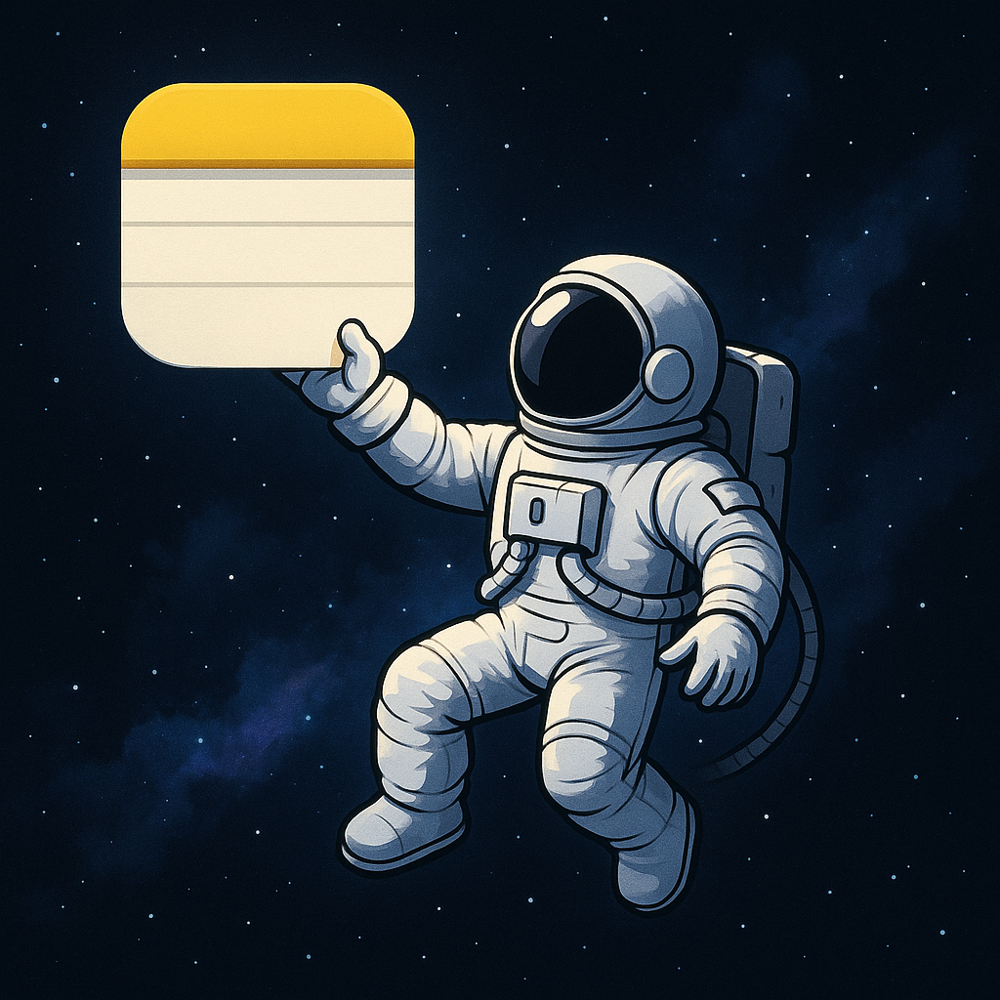
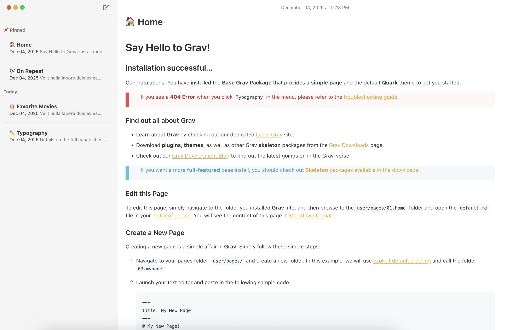

<p align="center">



# Apple Notes Theme for Grav

A beautiful, minimalist Grav theme inspired by Apple Notes, ported from the original Next.js design by [Alanagoyal](https://alanagoyal.com/notes).
</p>
## Credits

**Original Design**: All design credit goes to [Alanagoyal](https://alanagoyal.com/notes) for creating the original Apple Notes-inspired theme. This is a port to Grav CMS, which I believe is the perfect tool for this type of content-focused, markdown-based note-taking experience.

**Port to Grav**: This Grav theme port was created by [Paul Massendari](https://github.com/paulmassen).

## Screenshot

<p align="center">
  
</p>


## Features

- 🎨 **Apple Notes-inspired Design**: Clean, minimalist interface that mimics the Apple Notes aesthetic
- 📝 **Markdown Support**: Full GitHub Flavored Markdown support with syntax highlighting
- 🌓 **Dark Mode**: Three modes available - disabled, enabled, or auto (follows system preference)
- 📱 **Responsive Design**: Fully responsive with mobile-optimized sidebar and navigation
- 🔍 **Search**: Full-text search through TNTSearch, with a built-in fallback that filters titles and excerpts when the plugin is not installed
- ⌨️ **Keyboard Shortcuts**: Navigate notes with `j`/`k` or arrow keys, `/` to search, toggle theme with `t`
- 📌 **Pinned Notes**: Pin important notes to the top of your sidebar
- 📅 **Smart Grouping**: Notes automatically grouped by date (Today, Yesterday, Previous 7 Days, etc.)
- 🎯 **Emoji Support**: Custom emoji per note with configurable default emoji
- ✅ **Task Lists**: `- [ ]` / `- [x]` items are rendered as Apple Notes-style checkboxes
- 🤖 **Grav 2 ready**: works on Grav 1.7 and Grav 2.x (Admin 2, Markdown output for AI agents)

## Requirements

- Grav 1.7 or Grav 2.x
- PHP 7.3.6+ on Grav 1.7, PHP 8.3+ on Grav 2
- [TNTSearch Plugin](https://github.com/trilbymedia/grav-plugin-tntsearch) 3.x (installed automatically by GPM; without it the search only filters titles and excerpts)

After installing TNTSearch, build its index once: `bin/plugin tntsearch index`.

## Installation

### Via GPM (Grav Package Manager)

```bash
bin/gpm install apple-notes
```

### Manual Installation

1. Download the theme from the [GitHub releases page](https://github.com/paulmassen/grav-theme-applenotes/releases)
2. Extract the zip file to `user/themes/`
3. Rename the folder to `apple-notes`

### Activate the Theme

1. Navigate to your Grav Admin panel
2. Go to **Themes** → **Apple Notes**
3. Click **Activate**

## Configuration

The theme can be configured through the Grav Admin panel or in `user/config/themes/apple-notes.yaml` (do not edit the file inside the theme folder, it is replaced on updates):

```yaml
default_emoji: '📝'  # Emoji used for notes without an `emoji` in their frontmatter
dark_mode: 'auto'    # Options: 'disabled', 'enabled', 'auto'
```

### Dark Mode Options

- **disabled**: Always use light mode
- **enabled**: Dark mode by default
- **auto**: Automatically follow system preference

With `enabled` and `auto`, visitors can switch with the `t` key; their choice is remembered in the browser.

## Development

### Prerequisites

- Node.js and npm

### Setup

```bash
cd user/themes/apple-notes
npm install
```

### Build CSS

The theme uses Tailwind CSS. Build the CSS with:

```bash
# Development build (single)
npm run build

# Development build (watch mode)
npm run watch

# Production build (minified)
npm run prod
```

**Important**: The `css/apple-notes.css` file is auto-generated (and committed, so the theme works without a build step). Only edit `css/source.css` and rebuild.

If `npm run build` fails with `Cannot find module './cli/index'`, your `node_modules/.bin` links are broken: delete `node_modules` and run `npm install` again.

## Structure

```
apple-notes/
├── blueprints/          # Theme configuration blueprints
├── css/
│   ├── source.css       # Tailwind source (edit this)
│   ├── apple-notes.css  # Generated CSS (auto-generated)
│   ├── custom.css       # Custom styles
│   └── github-markdown.css  # Markdown styles
├── images/              # Theme images and icons
├── js/
│   └── apple-notes.js   # Theme JavaScript
├── templates/           # Twig templates
│   ├── default.html.twig
│   ├── error.html.twig
│   └── partials/       # Template partials (base.html.twig holds the sidebar layout)
└── package.json        # Node dependencies
```

## Usage

### Creating Notes

Create notes as regular Grav pages. The theme will automatically:

- Display them in the sidebar grouped by date
- Support markdown content
- Show emoji from page frontmatter
- Allow pinning via frontmatter

### Note Frontmatter

```yaml
---
title: My Note Title
emoji: 📝
pinned: true
date: 2024-01-15
---

Your markdown content here...
```

### Keyboard Shortcuts

- `j` or `↓`: Navigate to next note
- `k` or `↑`: Navigate to previous note
- `/`: Focus the search field (`Enter` opens the first result)
- `t`: Toggle dark/light theme (unless dark mode is disabled)
- `Esc`: Clear search or blur input

## Customization

### Colors

Edit `css/source.css` to customize the color scheme. The theme uses CSS custom properties:

```css
:root {
    --background: 0 0% 100%;
    --foreground: 0 0% 20%;
    /* ... */
}

.dark {
    --background: 0 0% 12%;
    --foreground: 0 0% 98%;
    /* ... */
}
```

### "New note" button

The pencil button in the sidebar does nothing by default. Define `window.createNewNote()` in your own script, or listen to the `apple-notes:new-note` event on `document`, to give it a behaviour (for example, open the admin).

### Mobile layout

On small screens the home page shows the notes list and every other page shows the note, with a **Notes** back button. Plugin pages that extend `partials/base.html.twig` and fill `` are rendered in the same layout.

## Browser Support

- Chrome (latest)
- Firefox (latest)
- Safari (latest)
- Edge (latest)

## License

MIT License - see [LICENSE](LICENSE) file for details.

## Credits & Acknowledgments

- **Original Design**: [Alanagoyal](https://alanagoyal.com/notes) - All design credit goes to the original creator
- **Grav Port**: [Paul Massendari](https://github.com/paulmassen)

## Contributing

Contributions are welcome! Please feel free to submit a Pull Request.

## Support

- **Issues**: [GitHub Issues](https://github.com/paulmassen/grav-theme-applenotes/issues)
- **Documentation**: [GitHub Wiki](https://github.com/paulmassen/grav-theme-applenotes/wiki)

## Changelog

See [CHANGELOG.md](CHANGELOG.md) for a list of changes and version history.

---

Made with ❤️ for the Grav community
